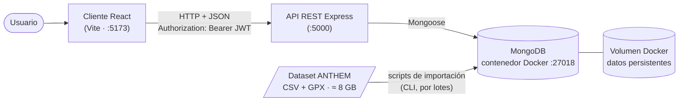
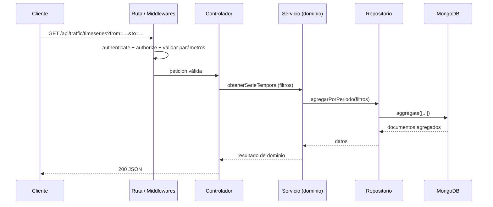

# Arquitectura del Sistema

> Versión 0.1 · Última actualización: 2026-10-27 · Estado: borrador inicial

> Las partes marcadas como **(propuesta)** son decisiones de diseño todavía por validar con los datos reales o en un sprint posterior. El resto describe lo ya establecido.

---

## 1. Visión general

Smart City Management es una aplicación web de tres capas físicas (cliente, API y base de datos) más un proceso de importación por lotes que carga el dataset ANTHEM en la base de datos.



| Componente | Responsabilidad | Tecnología |
|------------|-----------------|------------|
| **Cliente** | Interfaz: dashboards, filtros, mapas, login | React + Vite |
| **API** | Reglas de negocio, autenticación, consulta y agregación de datos | Node.js + Express (ESM) |
| **Base de datos** | Almacenamiento del dataset y de los usuarios | MongoDB en Docker + volumen |
| **Importadores** | Cargan, limpian y normalizan el dataset (fuera del ciclo de la API) | Scripts Node.js |

---

## 2. Principios de diseño

1. **Separación en capas** en el servidor: vista → dominio → persistencia. Cada capa solo habla con la siguiente.
2. **El dominio no conoce Express ni Mongoose.** Facilita las pruebas y permite cambiar de framework o de base de datos.
3. **Importar no es servir.** La carga del dataset es un proceso aparte, repetible y sin impacto en la API.
4. **La base de datos hace el trabajo pesado.** Con 8 GB, las agregaciones se resuelven en MongoDB (índices y *aggregation pipelines*), no en Node ni en el navegador.
5. **Configuración por entorno**, nunca en el código. Los secretos no se versionan.

---

## 3. Arquitectura del servidor (capas)

### 3.1 Capas y responsabilidades

| Capa | Carpeta | Contiene | Reglas |
|------|---------|----------|--------|
| **Vista** (HTTP) | `server/src/api/` | Rutas, controladores, middlewares (auth, errores, validación), validadores | Traduce HTTP ↔ dominio. No contiene lógica de negocio |
| **Dominio** | `server/src/domain/` | Servicios y errores de dominio (cálculo de KPIs, permisos, reglas) | No importa Express ni Mongoose. Recibe repositorios, devuelve datos |
| **Persistencia** | `server/src/models/` | Modelos Mongoose y repositorios (consultas y agregaciones) | Único lugar que conoce MongoDB |
| **Configuración** | `server/src/config/` | `env.js`, `db.js` | Variables de entorno y conexión |

Flujo de una petición:

```
Request → route → controller → service (dominio) → repository (persistencia) → MongoDB
```



### 3.2 Estructura de carpetas

```
server/
├── .env.example
├── package.json
├── scripts/                      # (propuesta) puntos de entrada CLI
│   └── import/                   #   importadores por dominio
├── tests/
└── src/
    ├── app.js                    # Configura Express (sin listen)
    ├── server.js                 # Valida entorno, conecta a la BD y arranca
    ├── config/
    │   ├── env.js
    │   └── db.js
    ├── api/
    │   ├── routes/               # index.js monta /auth, /users, /traffic…
    │   ├── controllers/
    │   ├── middlewares/          # authenticate, authorize, errorHandler, validate
    │   └── validators/
    ├── domain/
    │   ├── services/
    │   └── errors/
    └── persistence/
        ├── models/
        └── repositories/
```

`app.js` y `server.js` están separados para poder probar la API con Supertest sin abrir un puerto.

### 3.3 Transversales

| Aspecto | Solución |
|---------|----------|
| Errores | `notFound` + `errorHandler`; respuesta uniforme `{ "error": { "message", "status" } }`; sin detalles internos en producción |
| Validación | Esquemas por endpoint (`zod` o `joi`) en `api/validators/` |
| Seguridad HTTP | `helmet`, `cors` restringido a `CLIENT_URL`, límite de intentos en `/api/auth/*` |
| Logging | `morgan` (formato `dev` o `combined` según entorno) |
| Configuración | `process.env` leído solo en `config/env.js`; arranque con `node --env-file=.env` |

---

## 5. Modelo de datos (propuesta)

El dataset mezcla varios tipos de información, y cada uno recibe un tratamiento distinto en MongoDB.

| Tipo | Ejemplos | Estrategia en MongoDB |
|------|----------|-----------------------|
| **Mediciones temporales** (mucho volumen) | Tráfico (cada 15 min), aforo de peatones y bicicletas, calidad del aire, ruido, disponibilidad de bicicletas, ocupación de aparcamientos | Colecciones **time series** (MongoDB ≥ 5.0): `timeField` = instante, `metaField` = estación o punto de medida |
| **Eventos** | Accidentalidad, multas, objetos perdidos de taxi | Colecciones normales con índices por fecha, distrito y tipo |
| **Catálogos y ubicaciones** | Puntos de medida de tráfico, estaciones de ruido, contenedores, fotovoltaicas, paradas, estacionamiento regulado, callejero, GPX | Colecciones normales con campo `location` GeoJSON y **índice `2dsphere`** |
| **Agregados demográficos** | Censo | Colección normal indexada por distrito, barrio y sección |
| **Aplicación** | Usuarios, historial de importaciones | Colecciones normales (`users`, `importRuns`) |

---

## 7. API REST

### 7.1 Convenciones

- Prefijo `/api`, JSON en peticiones y respuestas.
- Autenticación: cabecera `Authorization: Bearer <token>`.
- Errores: `{ "error": { "message": "…", "status": 404 } }`.
- Paginación: `?page=1&limit=50`. Filtros: `?from=2024-01-01&to=2024-01-31&district=3`.

---


## 8. Despliegue y entorno local

### 8.1 Entorno de desarrollo

| Servicio | Puerto | Cómo se ejecuta |
|----------|:------:|-----------------|
| MongoDB | 27018 | Contenedor Docker con volumen |
| API | 5000 | `npm run dev` en `server/` |
| Cliente | 5173 | `npm run dev` en `client/` |

### 8.2 MongoDB en Docker (configuración de referencia)

Ajústala a tu contenedor actual. Se recomienda MongoDB 7 por el soporte de colecciones time series.

```yaml
# docker-compose.yml (raíz del repositorio)
services:
  mongo:
    image: mongo:7
    container_name: smartcity-mongo
    restart: unless-stopped
    ports:
      - "127.0.0.1:27018:27017"   # solo accesible desde la propia máquina
    environment:
      MONGO_INITDB_ROOT_USERNAME: ${MONGO_ROOT_USER}
      MONGO_INITDB_ROOT_PASSWORD: ${MONGO_ROOT_PASSWORD}
    volumes:
      - mongo_data:/data/db        # volumen persistente

volumes:
  mongo_data:
```

```bash
docker compose up -d mongo      # arrancar
docker compose down             # parar (los datos se conservan en el volumen)
docker compose down -v          # ⚠️ parar y BORRAR el volumen (se pierden los datos)
```

Con autenticación activada, la cadena de conexión incluye usuario y `authSource`:

```env
MONGO_URI=mongodb://<usuario>:<contraseña>@localhost:27018/anthem?authSource=admin
```

> El volumen contiene la base de datos ya cargada (varios GB). Evita `down -v` salvo que quieras volver a importar el dataset. La política de copias está en el Plan de gestión de la configuración.

### 8.3 Producción (a definir)

Pendiente de decidir (no antes de `v1.0.0`): construcción del cliente (`npm run build`), servidor Express o proxy inverso sirviendo el cliente estático, MongoDB en contenedor o servicio gestionado, y variables de entorno propias del entorno.

---

## 9. Atributos de calidad y decisiones

### 9.1 Cómo se satisface cada requisito no funcional

| Requisito | Decisión de arquitectura |
|-----------|--------------------------|
| RNF-01 Rendimiento | Índices, colecciones time series, agregaciones en MongoDB, pre-agregación si hace falta |
| RNF-02 Escalabilidad de datos | Importación en streaming y por lotes, fuera de la API |
| RNF-03 / RNF-04 Seguridad | JWT + `bcrypt`, `authenticate` y `authorize`, `helmet`, `cors`, rate limit |
| RNF-06 Mantenibilidad | Capas, ESM, linting, módulos por dominio |
| RNF-07 Testabilidad | `app.js` separado de `server.js`; servicios sin dependencia de Express ni Mongoose |
| RNF-08 Portabilidad | MongoDB en Docker con volumen |

### 9.2 Registro de decisiones

| ID | Decisión | Estado | Motivo |
|----|----------|--------|--------|
| AD-01 | Arquitectura en capas: vista, dominio, persistencia | ✅ Adoptada | Separación de responsabilidades y facilidad de pruebas |
| AD-02 | No usar `express-generator`; servidor montado a mano en ESM | ✅ Adoptada | Genera vistas y código antiguo que no encajan con React ni con las capas |
| AD-03 | MongoDB en contenedor Docker con volumen de datos | ✅ Adoptada | Entorno reproducible y datos persistentes |
| AD-04 | `--env-file` de Node en lugar de `dotenv` y `nodemon` | ✅ Adoptada | Menos dependencias (requiere Node ≥ 20.6) |
| AD-05 | Importación mediante scripts CLI, no mediante la API | 🟡 Propuesta | Volumen de 8 GB, repetibilidad y aislamiento |
| AD-06 | Colecciones time series para mediciones | 🟡 Propuesta | Rendimiento y compresión con series temporales |
| AD-07 | Datos geográficos normalizados a WGS84 con GeoJSON y `2dsphere` | 🟡 Propuesta | Tres sistemas de coordenadas en el dataset |
| AD-08 | Almacenamiento del token JWT (`localStorage` o cookie `httpOnly`) | ⏳ Pendiente (Sprint 2) | Compromiso entre simplicidad y seguridad frente a XSS |
| AD-09 | Librerías de gráficos y mapas (Recharts, Leaflet) | ⏳ Pendiente | Decidir antes del Sprint 3 |