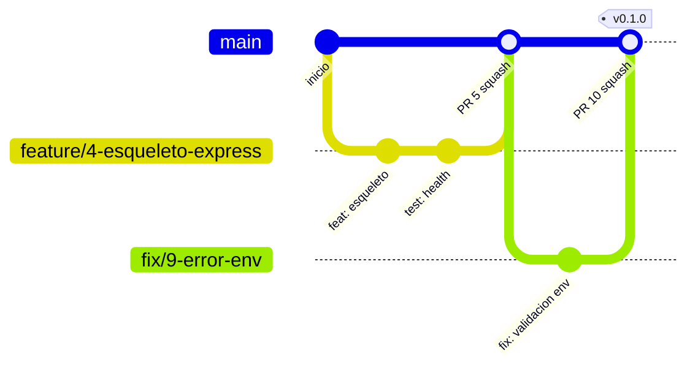
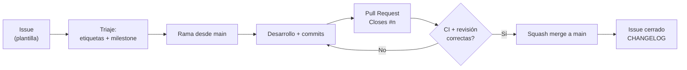

# Plan de Gestión de Configuración

> Versión 0.1 · Última actualización: 2026-10-27 · Estado: borrador inicial

---

## 1. Introducción

### 1.1 Propósito

Definir cómo se identifican, versionan, controlan y auditan los elementos del proyecto **Smart City Management** (código, documentación, configuración y datos), para que el trabajo sea reproducible y los cambios sean trazables.

### 1.2 Alcance

Aplica a todo el repositorio (`client/`, `server/`, documentación), a la wiki, a la configuración de entornos y al dataset ANTHEM.

### 1.3 Roles

En un equipo pequeño una misma persona puede asumir varios roles.

| Rol | Responsabilidades |
|-----|-------------------|
| **Responsable de configuración** | Mantiene este plan, protege la rama `main`, gestiona releases y baselines |
| **Desarrolladores** | Crean ramas, escriben código y documentación, abren Pull Requests |
| **Revisores** | Revisan los Pull Requests y verifican los criterios de aceptación |

---

## 2. Identificación de la configuración

### 2.1 Elementos de configuración (CI)

| Código | Elemento | Ubicación | Control |
|--------|----------|-----------|---------|
| CI-01 | Código del cliente | `client/` | Git |
| CI-02 | Código del servidor | `server/` | Git |
| CI-03 | Scripts de importación | `server/scripts/` *(propuesta)* | Git |
| CI-04 | Dependencias y versiones | `package.json` y `package-lock.json` de cada proyecto | Git |
| CI-05 | Configuración de herramientas | ESLint, Prettier, `.gitignore`, `.nvmrc` | Git |
| CI-06 | Plantilla de entorno | `server/.env.example`, `client/.env.example` | Git |
| CI-07 | Infraestructura local | `docker-compose.yml` | Git |
| CI-08 | Documentación | `README.md`, `CHANGELOG.md`, `LICENSE` | Git |
| CI-09 | Wiki | Repositorio `smart-city-management.wiki` | Git (repositorio de la wiki) |
| CI-10 | Issues, Milestones y etiquetas | GitHub | GitHub |
| CI-11 | Dataset ANTHEM (ficheros originales) | **Fuera de Git** (ver sección 7) | Manifiesto versionado |
| CI-12 | Base de datos cargada | Volumen Docker | Copias con `mongodump` |
| CI-13 | Secretos y archivos `.env` | Máquina local / gestor de secretos | **No versionados** |

### 2.2 Convenciones de nombres

| Elemento | Convención | Ejemplo |
|----------|-----------|---------|
| Repositorio | `kebab-case` | `smart-city-management` |
| Ramas | `<tipo>/descripcion-corta` | `feature/login-jwt` |
| Commits | Conventional Commits | `feat(auth): añade endpoint de login` |
| Tags | `vMAYOR.MENOR.PARCHE` | `v0.1.0` |
| Milestones | `Sprint N – Título` | `Sprint 1 – Setup y base del proyecto` |
| Archivos de código | Componentes React en `PascalCase`; el resto en `camelCase` o `kebab-case` de forma consistente | `KpiCard.jsx`, `errorHandler.js` |
| Páginas de la wiki | `Palabras-Con-Guiones` | `Arquitectura-del-Sistema` |

---

## 3. Control de versiones

### 3.1 Herramientas

Git y GitHub. La rama principal es `main`.

### 3.2 Estrategia de ramas (GitHub Flow)

- `main` contiene siempre código estable y en funcionamiento. **No se hacen commits directos.**
- Cada cambio nace de un issue, en una rama corta creada desde `main`.
- Tipos de rama: `feature/`, `fix/`, `docs/`, `chore/`, `refactor/`, `test/`.
- Las ramas se eliminan tras fusionar.

### 3.3 Mensajes de commit

Formato: `tipo(ámbito opcional): descripción en imperativo`.

| Tipo | Uso |
|------|-----|
| `feat` | Nueva funcionalidad |
| `fix` | Corrección de un error |
| `docs` | Documentación |
| `refactor` | Cambio interno sin efecto funcional |
| `test` | Pruebas |
| `chore` | Tareas de mantenimiento, dependencias, configuración |

### 3.4 Pull Requests

Un Pull Request debe:

1. Referenciar el issue (`Closes #n`).
2. Pasar el lint y las pruebas (cuando exista CI).
3. Contar con al menos **una revisión aprobada** (si el equipo es de una sola persona, autorrevisión con la lista de comprobación).
4. Fusionarse con **squash merge**, para mantener el historial de `main` limpio.

**Lista de comprobación de la plantilla de PR:**

- [ ] El cambio cumple los criterios de aceptación del issue
- [ ] `npm run lint` pasa
- [ ] Las pruebas pasan o se han añadido las necesarias
- [ ] No se incluyen secretos, `.env` ni datos del dataset
- [ ] Documentación actualizada (README, wiki, `.env.example`) si procede

### 3.5 Protección de `main` (ajustes en GitHub)

- Exigir Pull Request antes de fusionar.
- Exigir que pasen las comprobaciones de CI.
- Bloquear *force push* y borrado de la rama.

---

## 4. Versionado y releases

### 4.1 Versionado semántico

`MAYOR.MENOR.PARCHE`:

| Parte | Cuándo aumenta |
|-------|----------------|
| MAYOR | Cambios incompatibles de la API o del modelo de datos (a partir de `v1.0.0`) |
| MENOR | Nueva funcionalidad compatible; en este proyecto, **un hito (milestone) por sprint** |
| PARCHE | Correcciones |

Mientras la versión sea `0.x`, la API se considera inestable.

### 4.2 Baselines

Una *baseline* es una versión aprobada y etiquetada de la configuración.

| Baseline | Hito | Contenido |
|----------|------|-----------|
| `v0.1.0` | Sprint 1 | Estructura, API en capas, conexión a MongoDB, módulo de ejemplo, cliente base |
| `v0.2.0` | Sprint 2 | Autenticación, roles, rutas protegidas |
| `v0.3.0` | Sprint 3 *(provisional)* | Importación del dataset y primeros dashboards |
| `v0.4.0` | Sprint 4 *(provisional)* | Mapas y dashboards avanzados |
| `v1.0.0` | — *(provisional)* | Primera versión estable |

### 4.3 Procedimiento de release

1. Todos los issues del milestone están cerrados (o reasignados con justificación).
2. Actualizar `CHANGELOG.md` (formato *Keep a Changelog*).
3. Actualizar la versión en los `package.json`.
4. Comprobar la lista de verificación de la sección 9.
5. Crear el tag `vX.Y.Z` sobre `main` y la **GitHub Release** con las notas.
6. Cerrar el milestone.
7. Actualizar la hoja de ruta del README.

---

## 5. Control de cambios

### 5.1 Flujo de un cambio

### 5.2 Etiquetas de issues

| Tipo | Etiquetas |
|------|-----------|
| Área | `backend`, `frontend`, `persistence`, `domain`, `docs`, `setup`, `tooling`, `testing`, `security`, `auth`, `data` |
| Tipo | `feature`, `bug`, `chore`, `change-request` |
| Estado / prioridad | `blocked`, `good first issue`, `priority:high` |

### 5.3 Cambios en los requisitos

Los cambios de alcance se tratan como **solicitudes de cambio**:

1. Se abre un issue con la etiqueta `change-request` que describe el cambio y su impacto (sprint, arquitectura, esfuerzo).
2. El responsable de configuración lo aprueba o rechaza y lo asigna a un milestone.
3. Se actualiza la página de [Requisitos](Requisitos) (nuevo `RF` o `RNF`) y, si procede, [Arquitectura del Sistema](Arquitectura-del-Sistema).
4. Se anota en el historial de versiones de la página.

### 5.4 Cambios urgentes (hotfix)

Se crea una rama `fix/` desde `main`, se abre un PR con prioridad alta, se fusiona tras la verificación mínima y se publica una versión de parche (`vX.Y.Z+1`).

---

## 6. Entornos y configuración

### 6.1 Entornos

| Entorno | Propósito | Base de datos | Configuración |
|---------|-----------|---------------|---------------|
| **Desarrollo** | Trabajo diario | MongoDB en Docker (volumen local) | `server/.env`, `client/.env` |
| **Test** | Pruebas automáticas | Base de datos aislada (otra BD o instancia efímera) | Variables propias del test |
| **Producción** | A definir | A definir | Variables del entorno de despliegue |

### 6.2 Variables de entorno

| Variable | Ámbito | Descripción | Sprint |
|----------|--------|-------------|:------:|
| `PORT` | server | Puerto de la API (5000) | 1 |
| `NODE_ENV` | server | `development`, `test` o `production` | 1 |
| `MONGO_URI` | server | Cadena de conexión a MongoDB (**obligatoria**) | 1 |
| `CLIENT_URL` | server | Origen permitido por CORS | 1 |
| `JWT_SECRET` | server | Clave de firma de tokens (**obligatoria desde el Sprint 2**) | 2 |
| `JWT_EXPIRES_IN` | server | Caducidad del token (por ejemplo, `7d`) | 2 |
| `MONGO_ROOT_USER`, `MONGO_ROOT_PASSWORD` | Docker | Credenciales del contenedor de MongoDB | 1 |
| `VITE_API_URL` | client | URL base de la API | 1 |

**Reglas:**

- `.env` y `.env.*` están en `.gitignore`; solo se versiona `.env.example` (sin valores reales).
- Cada vez que se añade una variable, se actualiza `.env.example`, esta tabla y el README, en el mismo Pull Request.
- `validateEnv()` debe fallar al arrancar si falta una variable obligatoria.
- Los secretos de producción nunca se comparten por chat ni por correo. Si un secreto se sube por error, se **rota** inmediatamente (borrarlo del historial no basta).

### 6.3 Dependencias y entorno de ejecución

- Se versionan los `package-lock.json`; la instalación reproducible se hace con `npm ci`.
- Versión de Node declarada en `engines` (`>=20.6.0`) y en `.nvmrc`.
- Las dependencias se añaden con un propósito claro; cada adición relevante se justifica en el PR.
- *(Recomendado)* Activar Dependabot para avisos de seguridad y actualizaciones semanales.
- Las actualizaciones de versión **mayor** de una dependencia se tratan como un cambio con su propio issue.

### 6.4 Archivos que no se versionan

El `.gitignore` del proyecto excluye `node_modules/`, `.env*` (salvo `.env.example`), builds (`dist/`, `build/`), logs, carpetas de IDE (`.vscode/`, salvo `extensions.json`), archivos del sistema, `uploads/`, `data/db/`, claves y certificados.

---

## 7. Gestión del dataset y de la base de datos

El dataset ANTHEM (≈ 8 GB) es un elemento de configuración especial: es **demasiado grande para Git** (ni siquiera Git LFS es recomendable a este tamaño), pero la reproducibilidad depende de él.

### 7.1 Principio

> En Git se versiona **cómo obtener y cargar** los datos, no los datos.

### 7.2 Qué se versiona

| Elemento | Ubicación |
|----------|-----------|
| Manifiesto del dataset: lista de ficheros, tamaño, **checksum SHA-256**, fecha de obtención y fuente | `data/README.md` o `data/manifest.json` |
| Scripts de importación y reglas de calidad | `server/scripts/import/` |
| Documentación del dataset | Página de Requisitos, Anexo A |

### 7.3 Dónde se guardan los ficheros originales

- Carpeta local ignorada por Git (`data/raw/`).
- Copia de seguridad en un almacenamiento externo del equipo (unidad compartida, almacenamiento en la nube). Se anota su ubicación en el manifiesto.
- Los ficheros originales **no se modifican**: toda limpieza se hace en la importación.

### 7.4 Base de datos cargada (volumen Docker)

| Operación | Procedimiento |
|-----------|---------------|
| Reconstruir la BD | Levantar MongoDB y ejecutar los scripts de importación sobre los ficheros originales (importación idempotente) |
| Copia de seguridad | `mongodump --uri="$MONGO_URI" --archive=backup.gz --gzip` |
| Restauración | `mongorestore --uri="$MONGO_URI" --archive=backup.gz --gzip` |
| Eliminación del volumen | `docker compose down -v` (**solo** si se va a reimportar) |

Como la BD se puede regenerar desde los ficheros originales, el elemento crítico que debe respaldarse es **el dataset original** y, para ahorrar tiempo, opcionalmente un `mongodump` tras cada carga completa.

### 7.5 Datos personales

Los datos del dataset son agregados o de ubicaciones públicas. Los usuarios de la aplicación (`users`) sí contienen datos personales: no se incluyen en volcados compartidos ni en el repositorio, y las contraseñas solo existen como hash.

---

## 8. Auditoría y contabilidad de estado

### 8.1 Verificación antes de cada release

- [ ] Todos los issues del milestone están cerrados o reasignados
- [ ] `main` pasa lint, pruebas y build
- [ ] No hay secretos ni datos del dataset en el repositorio
- [ ] `.env.example` coincide con las variables realmente usadas
- [ ] README, wiki y `CHANGELOG.md` están actualizados
- [ ] Un clon limpio arranca siguiendo solo el README
- [ ] Las versiones de los `package.json` coinciden con el tag

### 8.2 Contabilidad de estado

El estado de la configuración se consulta en:

| Pregunta | Dónde |
|----------|-------|
| ¿Qué versión está estable? | Tags y Releases |
| ¿Qué se ha cambiado y por qué? | Historial de `main`, PRs e issues enlazados |
| ¿Qué falta para el siguiente hito? | Milestone (barra de progreso) |
| ¿Qué cambió en la documentación? | Historial de la wiki y tabla de versiones de cada página |

---

## 9. Gestión de la documentación

| Documento | Dónde | Quién y cuándo actualiza |
|-----------|-------|--------------------------|
| `README.md` | Repositorio | En cada cambio de instalación, scripts o variables de entorno |
| Wiki | Repositorio de la wiki | En cada hito, o cuando cambie un requisito o una decisión de arquitectura |
| Referencia de la API | Wiki *(a crear)* | Con cada endpoint nuevo |

- La wiki es un repositorio Git independiente (`<repo>.wiki.git`): se puede clonar y editar en local con los mismos mensajes de commit.
- `README.md` y Home comparten contenido; ante cualquier discrepancia, el README del repositorio es la fuente para la instalación.

---

## 10. Herramientas

| Herramienta | Uso |
|-------------|-----|
| Git / GitHub | Control de versiones, Issues, Milestones, Pull Requests, Releases |
| npm | Gestión de dependencias |
| Docker / Docker Compose | MongoDB y entorno local |
| ESLint y Prettier | Calidad y formato del código |
| Vitest o Jest + Supertest | Pruebas |
| `mongodump` / `mongorestore` | Copias de seguridad de la base de datos |
| Dependabot | Alertas y actualizaciones de dependencias |

---

## 11. Historial de versiones de esta página

| Versión | Fecha | Cambios |
|---------|-------|---------|
| 0.1 | 2026-10-27 | Versión inicial |